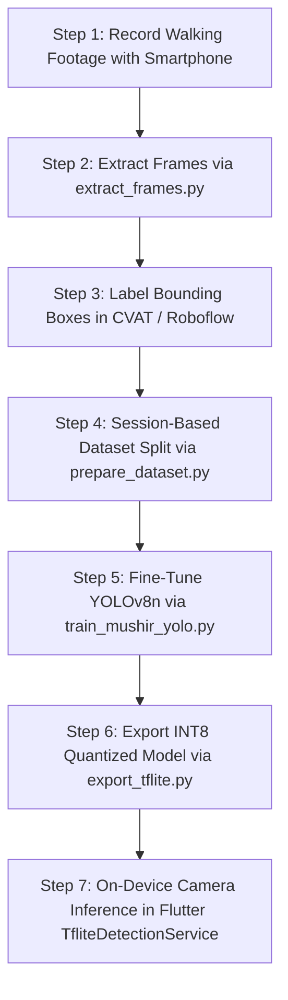

# Mushir — Custom Model Training & Indian Footpath Dataset Guide

This document provides a step-by-step engineering workflow for training, fine-tuning, and deploying Mushir's on-device computer vision models on mobile phones.

---

## 1. Unified 21-Class Indian Pedestrian & Mobility Taxonomy

Configured in [`datasets/mushir.yaml`](../datasets/mushir.yaml) and [`flutter_app/assets/labels/mushir_labels.txt`](../flutter_app/assets/labels/mushir_labels.txt):

| Class ID | Class Name | Category | Real Height (m) | Danger Priority |
|:---:|:---|:---|:---:|:---:|
| **0** | `person` | Dynamic Pedestrian | 1.70 m | Normal |
| **1** | `auto_rickshaw` | Dynamic Traffic | 1.80 m | **High** |
| **2** | `two_wheeler` | Dynamic Traffic (Motorcycle/Scooter) | 1.15 m | **High** |
| **3** | `car` | Vehicle | 1.50 m | Normal |
| **4** | `bus` | Heavy Vehicle | 3.10 m | **High** |
| **5** | `truck` | Heavy Vehicle | 2.70 m | **High** |
| **6** | `bicycle` | Cycle | 1.05 m | Normal |
| **7** | `cattle` | Street Animal (Cow/Buffalo) | 1.40 m | **High** |
| **8** | `stray_dog` | Small Street Animal | 0.55 m | Normal |
| **9** | `pole` | Street Furniture (Electric/Lamp/Sign) | 3.50 m | **Critical** |
| **10** | `bollard` | Footpath Barrier | 0.85 m | **Critical** |
| **11** | `pothole` | Surface Hazard / Depression | 0.30 m | **Critical** |
| **12** | `open_manhole` | Severe Fall / Missing Cover | 0.40 m | **URGENT** |
| **13** | `stairs_down` | Descending Steps / Drop-off | 0.90 m | **URGENT** |
| **14** | `stairs_up` | Ascending Steps / Overpass | 1.30 m | **High** |
| **15** | `curb` | Sidewalk Edge Step | 0.20 m | **Critical** |
| **16** | `barricade` | Construction Barrier / Fence | 1.10 m | **High** |
| **17** | `vendor_cart` | Roadside Thela / Hawker Stall | 1.60 m | **High** |
| **18** | `tree_branch` | Overhead / Head-Height Hazard | 1.20 m | **Critical** |
| **19** | `traffic_light` | Signal | 2.50 m | Normal |
| **20** | `crosswalk` | Zebra Crossing Strip | 0.50 m | Normal |

---

## 2. End-to-End Workflow: From Street Video to Phone APK



---

## 3. Step-by-Step Instructions

### Step 1: Record Walking Footage
- **Camera Mount**: Chest strap or hand held at waist height (phone screen facing user, camera facing street).
- **Camera Tilt**: Tilted slightly downward (~10° to 15°) to capture both the immediate walking surface (curbs, potholes, stairs) and standing obstacles (poles, people, carts).
- **Varied Lighting**: Day, dusk, shade under trees, harsh direct sunlight.

### Step 2: Extract Clean Frames (Filtering Motion Blur)
Run the frame extractor to convert videos into images at ~2 frames per second while dropping blurry frames:
```bash
python scripts/extract_frames.py --video path/to/walk_video.mp4 --output_dir datasets/raw_frames/session_01 --fps 2.0 --min_blur_score 50.0
```
Or process a folder of multiple videos:
```bash
python scripts/extract_frames.py --video_dir path/to/all_videos/ --output_dir datasets/raw_frames/
```

### Step 3: Labeling
- Upload the extracted frames to **Roboflow** (Free tier) or self-hosted **CVAT**.
- Annotate boxes according to the 21 classes in `datasets/mushir.yaml`.
- Export annotations in **YOLOv8 format** (`.txt` files with `class x_center y_center width height`).

### Step 4: Split by Session (No Data Leakage)
Organize labeled sessions into Train, Val, and Test:
```bash
python scripts/prepare_dataset.py --source_dir datasets/labeled_sessions/ --output_dir datasets/mushir
```
Validate your dataset anytime:
```bash
python scripts/prepare_dataset.py --validate datasets/mushir
```

### Step 5: Fine-Tune YOLO
Train locally (or in Google Colab / Kaggle free GPU):
```bash
python scripts/train_mushir_yolo.py --epochs 80 --batch 16 --model yolov8n.pt
```

### Step 6: Export to TFLite
Convert best weights into INT8 quantized mobile format and deploy automatically to Flutter assets:
```bash
python scripts/export_tflite.py --weights runs/detect/mushir/weights/best.pt --int8
```
This automatically updates:
- `flutter_app/assets/models/mushir_yolov8n.tflite`
- `flutter_app/assets/labels/mushir_labels.txt`

### Step 7: Run on Android Device
Connect your Android phone via USB and run:
```bash
cd flutter_app
flutter run --release
```
The app will use `TfliteDetectionService` to run real-time inference on the camera stream, detect obstacles, calculate spatial sectors (Left, Center, Right), calculate optical distance, and speak alerts through your Bluetooth earphones.
